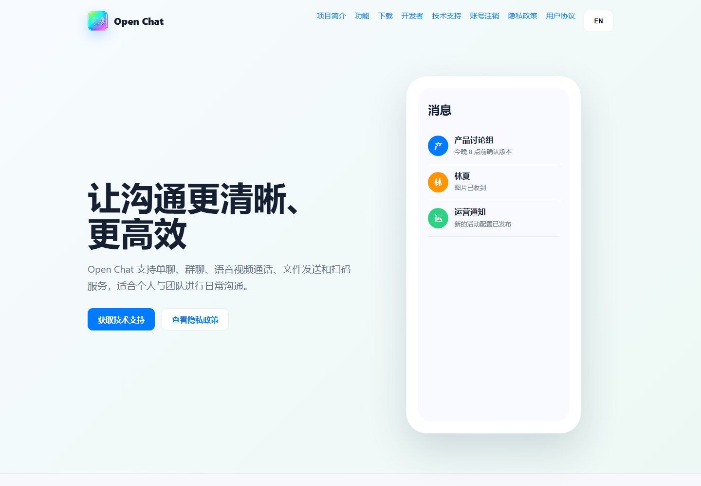
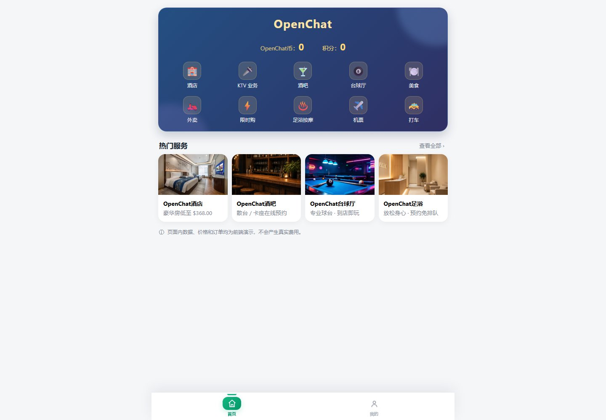
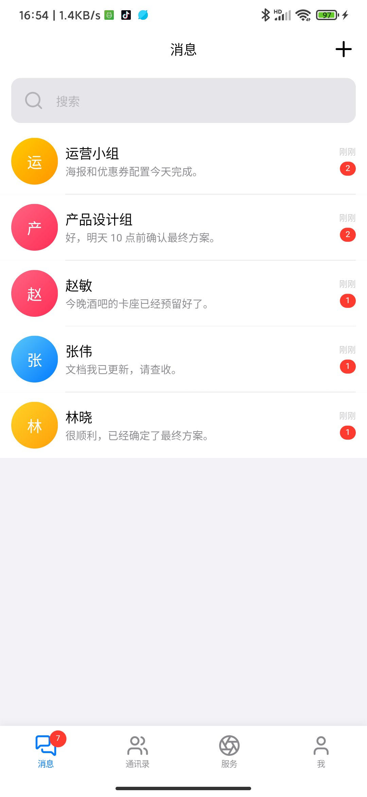
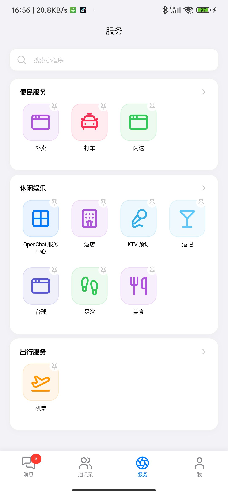

# OpenChat

[中文](README.md) | [English](README.en.md) · [产品介绍](docs/introduction/README.md) · [工程拓扑](docs/architecture/TOPOLOGY.zh.md) · [一键部署](#一键部署推荐)

[](https://github.com/openware-io/open-im-server/actions/workflows/docs-governance.yml)
[](LICENSE)

**开源的即时通讯 + 多租户 SaaS 一体化平台。**



OpenChat 把 IM 开放平台、多租户 SaaS、运营后台、移动端/桌面端和本地一键部署放在同一套工程体系里：既能作为可运行的产品底座，也能作为微服务、长连接可靠消息和多租户权限设计的参考实现。

<table>
  <tr>
    <td align="center"><br><sub>SaaS C 端</sub></td>
    <td align="center"><br><sub>App 会话</sub></td>
    <td align="center"><br><sub>App 服务板块</sub></td>
  </tr>
</table>

> 状态：`current`（`develop/2.3.0` 开发中；最近阶段 tag `2.2.1`）  
> 工程级拓扑与文档导航见[文档中心](./docs/README.md)和[工程拓扑](./docs/architecture/TOPOLOGY.zh.md)。

## 一键部署（推荐）

`deploy-k8s.ps1` 是完整本地环境的一键入口：构建业务镜像、导入 Kind、应用 Kubernetes 清单、等待服务健康并输出访问入口。该路径已在 Windows + Docker Desktop + Kind 环境完成全量部署验证。

### 环境要求

| 项目 | 要求 |
| --- | --- |
| 操作系统 | Windows 10/11，PowerShell 5.1+（推荐 PowerShell 7） |
| 容器运行时 | Docker Desktop，**Linux 容器模式**，Docker Engine 已启动 |
| Kubernetes 工具 | `kind`、`kubectl` 在 `PATH` 中；不需要启用 Docker Desktop 内置 Kubernetes |
| Java | JDK 25，`JAVA_HOME` 可用 |
| 构建工具 | 仓库自带 `mvnw.cmd`；首次运行需要访问 Maven/npm/Docker 依赖源，或已有本地缓存 |
| 版本控制 | Git |
| 配置 | 仓库根目录 `.env`；首次执行初始化脚本生成，按本机环境检查 |
| 端口 | 默认入口 `30080`；Docker/Kind 需要可用端口和足够磁盘 |
| 资源建议 | 16 GB RAM、4 vCPU、30 GB 可用磁盘（低于该配置可能因 JVM/Pod 数量导致启动超时） |

### 执行

```powershell
cd open-im-server

# 1. 生成 .env（已存在时不会覆盖；需要重建用 -Force）
powershell -NoProfile -ExecutionPolicy Bypass -File .\scripts\initialize-local-env.ps1

# 2. 检查 .env（数据库、Redis、MQ、MinIO 地址与密钥）
notepad .env

# 3. 一键构建并部署
powershell -NoProfile -ExecutionPolicy Bypass -File .\deploy-k8s.ps1
```

首次运行会构建全部业务镜像并下载依赖，耗时取决于网络和机器性能。

### 访问

部署完成后按本机地址访问：

| 入口 | 地址 |
| --- | --- |
| 统一门户 | `http://<本机IP>:30080/` |
| SaaS 管理后台 | `http://<本机IP>:30080/saas/` |
| SaaS C 端（H5） | `http://<本机IP>:30080/a380/` |
| SaaS B 端 / 运营后台 | `http://<本机IP>:30080/b/` |
| IM 管理后台 | `http://<本机IP>:30080/im/` |
| 网关健康检查 | `http://<本机IP>:30080/actuator/health` |
| 官网 | `http://<本机IP>:30080/website/` |

仅本机访问可使用 `http://127.0.0.1:30080/`；局域网设备访问需允许 `30080` 入站。

### 系统账号与口令

| 角色 | 用户名 | 口令来源 |
| --- | --- | --- |
| SaaS 管理员 | `admin` | 管理员种子账号；口令由部署环境设置/轮换，仓库不存明文 |
| B 端运营账号 | 已授予运营权限的 IM 账号 | 无独立 B 端口令，走 IM OAuth 登录 |
| IM 管理后台 | 由 SaaS 后台管理员体系管理 | 使用 `admin` 或已授权管理员账号 |

规则与位置：

- SaaS 管理员种子位于 `platform-services/admin/platform-admin-service/src/main/resources/db/migration/V1__cons_admin_account.sql`；迁移只写入 BCrypt `password_hash`，不写明文口令。
- `scripts/initialize-local-env.ps1` 只生成基础设施密钥（数据库、Redis、MongoDB、RocketMQ、MinIO 等），**不生成也不重置 SaaS 管理员口令**。
- 修改管理员口令：登录 SaaS 后台后调用 `POST /api/v1/admin/auth/password`（或对应后台页面）；修改后当前会话立即失效。
- 验收脚本不内置口令，统一从环境变量 `IM_SAAS_ADMIN_PASSWORD` 注入；未注入时脚本会明确报错。
- B 端不需要单独创建账号：在 SaaS 后台为某个 IM 账号授予运营权限和门店范围，然后从 `/b/` 走 IM OAuth 登录并选择门店。
- 本地人工冒烟已用 `admin` 账号验证；实际口令由部署者保管，不写入仓库或本文档。

### 验证与停止

```powershell
# 所有 Pod 应为 Running 且 Ready
kubectl --context kind-open-im-local get pods -n open-im-local

# 查看入口
kubectl --context kind-open-im-local get ingress -n open-im-local

# 停止并删除本地 Kind 环境
powershell -NoProfile -ExecutionPolicy Bypass -File .\deploy-k8s.ps1 -Stop
```

需要强制重建或清理旧镜像时使用：

```powershell
powershell -NoProfile -ExecutionPolicy Bypass -File .\deploy-k8s.ps1 -ForceRebuild -ForceRedeploy
powershell -NoProfile -ExecutionPolicy Bypass -File .\deploy-k8s.ps1 -ForceRedeploy -PruneImages
```

完整参数、数据生命周期和故障排查见[本地部署说明](./docs/deployment/LOCAL.md)。

## 当前服务拓扑

按“体验层 → 接入层 → SaaS 平台域 → IM 业务域 → 公共能力域 → 数据基础设施”组织，完整映射见[工程拓扑](./docs/architecture/TOPOLOGY.zh.md)。

- **L0 体验层**：`open-chat-app`、`open-chat-desktop`、`open-saas-admin`、`open-chat-admin`、`open-saas-mobile`、`open-website`
- **L1 接入层**：`gateway`（HTTPS REST 横切）、`im-access-ws`（WebSocket 接入）、`unified-portal`（统一登录）
- **L2 SaaS 平台域**：`platform-identity-service`、`platform-tenant-service`、`platform-admin-service`、`platform-customer-service`、`platform-order-service`、`platform-resource-service`、`platform-marketing-service`
- **L3 IM 业务域**：`im-user-service`、`im-message-service`、`im-conversation-service`、`im-admin-service`
- **L4 公共能力域**：`common-media-service`、`common-audit-service`、`common-mail-service`、`common-sms-service`、`common-payment-service`、`common-payment-channel-service`、`group-idaas-service`
- **L5 数据基础设施**：MySQL（`open_im` / `open_saas` / `open_group` / `open_audit`）、MongoDB（`im_chat`）、Redis、RocketMQ、MinIO

## 访问入口

- Gateway HTTP：`http://localhost:3002/api/v1/**`
- Gateway WSS：`ws://localhost:3002/ws/im/v1?ticket={one-time-ticket}`
- 用户服务默认端口：`3100`
- 消息服务默认端口：`3200`
- 会话服务默认端口：`3300`
- 管理服务默认端口：`3400`
- 订单服务默认端口：`3500`
- 媒体支撑服务默认端口：`3600`
- 长连接接入层默认端口：`3001`

除 Gateway HTTP/WSS 外，其余服务端口仅用于本地调试和服务间通信；客户端访问媒体控制面必须通过 Gateway 的 `/api/v1/media/**`，文件二进制直连受管对象存储地址。

## 路由约定

外部 REST API 统一使用 `/api/v1/**`。Gateway 对以下业务路由统一执行 `StripPrefix=2`，因此后端 Controller 接收的路径不包含 `/api/v1` 前缀。路由配置的唯一实现来源是 `gateways/gateway/src/main/resources/application.yml`；变更该文件时必须在同一变更中同步更新本表和[网关服务说明](./docs/services/gateway/README.md)。

| 客户端请求路径 | 转发后的服务内路径 | 目标服务 | 路由标识 | 说明 |
| --- | --- | --- | --- | --- |
| `/api/v1/auth/**` | `/auth/**` | `im-user-service` | `api-auth` | 注册、登录和一次性 WebSocket 凭证等认证能力。 |
| `/api/v1/users/**` | `/users/**` | `im-user-service` | `api-users` | 用户资料与账号能力。 |
| `/api/v1/device-tokens/**` | `/device-tokens/**` | `im-user-service` | `api-device-tokens` | 设备推送令牌管理。 |
| `/api/v1/friends/**` | `/friends/**` | `im-user-service` | `api-friends` | 好友关系和好友申请。 |
| `/api/v1/user-stickers/**` | `/user-stickers/**` | `im-user-service` | `api-user-stickers` | 用户贴纸能力。 |
| `/api/v1/messages/**` | `/messages/**` | `im-message-service` | `api-messages` | 消息发送、历史、已读与撤回。 |
| `/api/v1/favorites/**` | `/favorites/**` | `im-message-service` | `api-favorites` | 消息收藏与收藏列表。 |
| `/api/v1/conversations/**` | `/conversations/**` | `im-conversation-service` | `api-conversations` | 会话查询和管理。 |
| `/api/v1/groups/**` | `/groups/**` | `im-conversation-service` | `api-groups` | 群组、成员和群角色。 |
| `/api/v1/rtc/**` | `/rtc/**` | `im-conversation-service` | `api-rtc` | RTC 信令配置查询。 |
| `/api/v1/business/**` | `/business/**` | `platform-order-service` | `api-business-order` | 订单、KTV、预约与目录等业务编排。 |
| `/api/v1/media/**` | `/media/**` | `common-media-service` | `api-media` | 仅处理上传会话、完成确认、对象状态和访问授权；文件二进制由客户端直连对象存储。 |
| `/api/v1/admin/**` | `/admin/**` | `im-admin-service` | `api-admin` | 管理端后台业务接口。 |
| `/api/v1/config/client/**` | `/config/client/**` | `im-admin-service` | `api-client-config` | 客户端配置下发。 |
| `/api/v1/config/app-update` | `/config/app-update` | `im-admin-service` | `api-app-update` | 应用版本更新检查。 |
| `/api/v1/miniapp/services` | `/miniapp/services` | `im-admin-service` | `api-miniapp-services` | 服务板块公开读接口（C 端服务目录）。 |
| `/api/v1/reports/**` | `/reports/**` | `im-admin-service` | `api-reports` | 举报提交与处理。 |

| 客户端请求路径 | 目标服务 | 协议与约束 |
| --- | --- | --- |
| `/ws/im/v1?ticket={one-time-ticket}` | `im-access-ws` | WebSocket 长连接。客户端先调用 `POST /api/v1/auth/ws-ticket` 获取一次性 `ticket`；该入口不适用 REST 的 `StripPrefix=2` 规则。 |
| `/_docs/{user,message,conversation,order,support,admin}/api-docs` | 对应业务服务 | 仅供网关聚合 Swagger 使用；网关移除 `Authorization` 后转发，不属于客户端业务接口。 |

## 其他运行方式

除一键 Kind 部署外，仓库还提供另外两种相互独立的本地运行方式。完整的依赖条件、启动顺序、停止范围和验证步骤见[本地运行说明](./docs/deployment/LOCAL.md)；同一时刻应只选择一种方式运行完整环境。

| 方式 | 适用场景 | 入口命令 | 网关地址 |
| --- | --- | --- | --- |
| 直接运行本地进程 | 调试单个服务或 Java 断点；依赖的基础设施必须已由外部环境启动。 | `powershell -NoProfile -ExecutionPolicy Bypass -File .\deploy-local.ps1` | `http://127.0.0.1:3002` |
| Docker Compose | 日常本地联调；Docker Desktop 负责运行全部基础设施和业务容器。 | `powershell -NoProfile -ExecutionPolicy Bypass -File .\deploy-docker.ps1` | `http://127.0.0.1:3002` |
| 本地 Kubernetes（Kind） | 一键构建并部署完整 IM + SaaS；验证 Service 发现、滚动发布与 Pod 可追溯性。 | `powershell -NoProfile -ExecutionPolicy Bypass -File .\deploy-k8s.ps1` | `http://127.0.0.1:30080/saas/` |

直接运行完整环境时，优先使用 `deploy-local.ps1`，它会按依赖顺序启动所有服务。仅调试单个服务时使用 `run-dev.ps1`，并确保外部基础设施和上游服务已先就绪：

```powershell
powershell ./run-dev.ps1 -Service user
powershell ./run-dev.ps1 -Service conversation
powershell ./run-dev.ps1 -Service support
powershell ./run-dev.ps1 -Service order
powershell ./run-dev.ps1 -Service message
powershell ./run-dev.ps1 -Service admin
powershell ./run-dev.ps1 -Service access-ws
powershell ./run-dev.ps1 -Service gateway
```

## 文档索引

```text
im-saas 文档
├─ 入门
│  ├─ 产品介绍（./docs/introduction/README.md）
│  ├─ 文档中心（./docs/README.md）
│  ├─ 一键部署（README 顶部）
│  └─ 工程拓扑（./docs/architecture/TOPOLOGY.zh.md）
├─ 架构与治理
│  ├─ 架构总览（./docs/ARCHITECTURE.md）
│  ├─ 文档整理与归档方案（./docs/DOCUMENTATION_ORGANIZATION.md）
│  ├─ 文档审计（./docs/DOCUMENTATION_AUDIT.md）
│  ├─ 工程规范（./docs/ENGINEERING_RULES.md）
│  └─ 门禁注册表（./docs/GATE_REGISTRY.md）
├─ 部署与运行
│  ├─ 本地部署（./docs/deployment/LOCAL.md）
│  ├─ 部署索引（./docs/deployment/README.md）
│  └─ 发布手册（./docs/RELEASE_RUNBOOK.md）
├─ 服务
│  ├─ 接入层：Gateway / im-access-ws
│  ├─ IM 域：user / message / conversation / admin
│  ├─ SaaS 平台域：platform-*
│  └─ 公共能力域：common-* / group-idaas
├─ 业务与标准
│  ├─ 业务文档（./docs/business/）
│  └─ 标准（./docs/standards/）
└─ 历史归档
   ├─ renovation（./docs/renovation/）
   ├─ superpowers（./docs/superpowers/）
   └─ 审计快照（./docs/audit-2026-09-17-exceptions-and-i18n.md）
```

- 完整层级、阅读路径和双语覆盖见[文档中心](./docs/README.md)。
- 服务说明入口：[服务目录](./docs/services/)。
- 标准入口：[标准目录](./docs/standards/)。

### 标准目录

- [00 DDD 微服务软件工程规范纲要](./docs/standards/00_DDD_MICROSERVICE_SOFTWARE_ENGINEERING_OUTLINE.md)
- [10 DDD 服务工程规范](./docs/standards/10_DDD_SERVICE_ENGINEERING_CONVENTIONS.md)
- [12 RocketMQ 治理规范](./docs/standards/12_ROCKETMQ_CONVENTIONS.md)
- [13 平台媒体规范](./docs/standards/13_PLATFORM_MEDIA_CONVENTIONS.md)
- [14 客户端发布与版本治理规范](./docs/standards/14_CLIENT_RELEASE_GOVERNANCE.md)
- [15 客户端发布操作规范](./docs/standards/15_CLIENT_RELEASE_SKILL.md)
- [16 币种规范](./docs/standards/16_CURRENCY_CONVENTIONS.md)
- [20 Maven 工程规范](./docs/standards/20_MAVEN_ENGINEERING_CONVENTIONS.md)
- [21 持久层技术栈标准](./docs/standards/21_PERSISTENCE_STACK.md)
- [22 技术栈版本矩阵](./docs/standards/22_TECHNOLOGY_STACK_VERSION_MATRIX.md)
- [30 文本编码与批量改写规范](./docs/standards/30_TEXT_ENCODING_AND_BATCH_EDITING.md)
- [40 可观测性规范](./docs/standards/40_OBSERVABILITY_CONVENTIONS.md)
- [41 Java 日志规范](./docs/standards/41_JAVA_LOGGING_CONVENTIONS.md)
- [42 日志输出与诊断规范](./docs/standards/42_LOGGING_AND_OUTPUTS.md)
- [43 E2E 测试与验收规范](./docs/standards/43_E2E_TESTING_CONVENTIONS.md)
