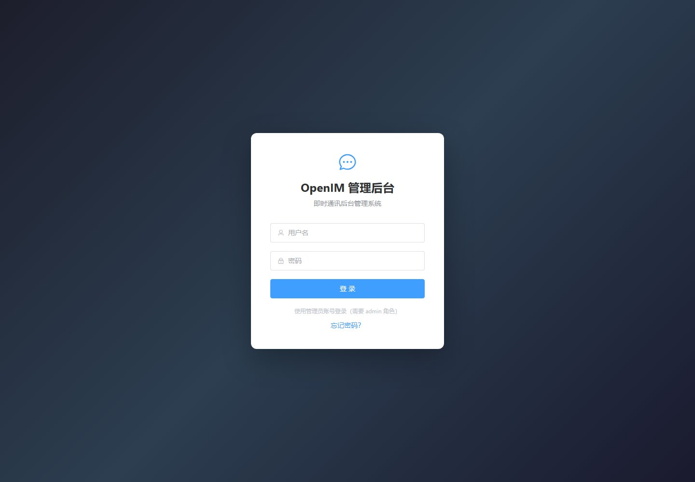
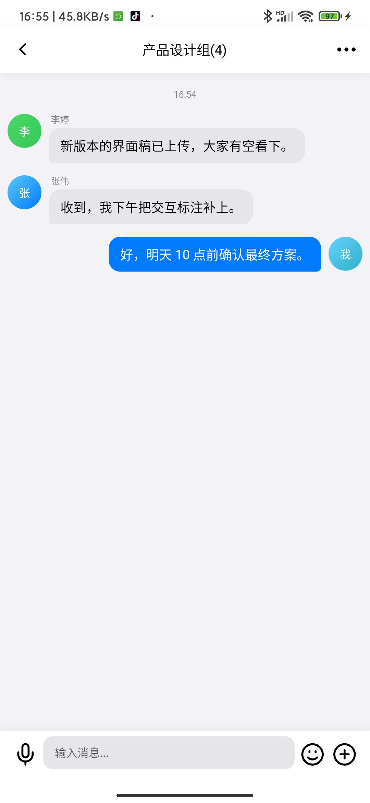

# OpenChat 产品介绍

[中文](README.md) | [English](README.en.md)

> 状态：`current`（`main`）  
> 一句话：**OpenChat 是一套开源的即时通讯 + 多租户 SaaS 一体化平台，覆盖移动端、桌面端、运营后台与本地一键部署。**


## 1. 这是什么

OpenChat 把两套通常分开建设的能力放在同一个工程体系里：

- **IM 开放平台**：单聊、群聊、频道、私密会话、WebSocket 长连接、消息可靠性与多端同步；
- **多租户 SaaS 平台**：租户/门店、账号与权限、会员/积分/钱包、KTV 预约与订单、支付、审计；
- **统一体验层**：OpenChat App、桌面端、SaaS C 端 H5、B 端商户工作台、IM 管理后台、SaaS 运营后台和官网。

它不是只提供聊天 SDK 的示例工程，而是一套可以本地完整跑起来、按域拆分、可继续演进的产品级底座。

## 2. 解决什么问题

| 常见问题 | OpenChat 的做法 |
| --- | --- |
| IM 与业务系统割裂 | IM 作为开放平台，SaaS 通过 OAuth/租户上下文接入，账号和权限统一 |
| 多租户、门店、角色难落地 | 平台账号、IM 账号、租户 IAM、门店范围分层建模 |
| 本地环境难复现 | Windows + Docker Desktop + Kind 一键构建、部署和验证 |
| 长连接与可靠消息难兼顾 | `im-access-ws` 接入，RocketMQ 削峰/保序，MySQL 权威落库，MongoDB 热投影 |
| 服务边界容易腐化 | 按 `api → application → domain ← infra` 分层，网关只做横切 |

## 3. 产品界面

### 3.1 官网与品牌入口


### 3.2 SaaS C 端服务板块

App 内的服务板块与 H5 首页，覆盖酒店、KTV、酒吧、台球、美食、外卖、出行等服务入口。

本地 demo 数据包含 `SaaS 生活服务` 租户、`OpenChat KTV 旗舰店`、6 个 KTV 包厢、服务目录、已支付/已完成订单和预约记录。


### 3.3 IM 管理后台

管理后台提供用户、会话、群组、客户端版本、开放平台应用和审计日志等管理能力。



### 3.4 SaaS 运营后台：权限目录矩阵

平台运营在“权限管理 → 权限目录”中，将权限清单与全局角色授权放在同一张表对照：

- 四态展示：已授予、可授予未授予、不可授予、越界授权；
- 支持按模块/业务域/作用域/状态筛选，可选择角色列对比；
- 页面会提示历史预置角色的跨作用域授权，便于发现权限治理问题；
- 只读视图，角色授权编辑仍在“角色与权限”页完成。

产品说明：[权限目录矩阵（产品说明）](PERMISSION_MATRIX.md)。

### 3.5 角色与权限页面

平台/租户后台统一提供“角色与权限”入口：

- 平台角色、租户角色、门店角色分层管理；
- 预置角色只读，支持复制为自定义角色；
- 权限矩阵保存带并发校验，权限数量批量加载；
- 平台角色可按 PLATFORM 可授予范围配置经营权限，并可跳转权限目录矩阵；
- 平台运营人员账号可授予/撤销平台角色；平台自定义角色停用前检查有效绑定；
- 租户后台提供“角色权限矩阵”，聚合本租户预置与自定义角色。

产品说明：[角色与权限页面（产品说明）](ROLE_MANAGEMENT.md)。

### 3.6 OpenChat App（小米 9 实机）

会话列表、群聊和服务板块来自真实运行的 Kind 环境；演示账号与消息均为本地 demo 数据。

<table>
  <tr>
    <td align="center"><br><sub>会话列表</sub></td>
    <td align="center"><br><sub>群聊</sub></td>
    <td align="center"><br><sub>服务板块</sub></td>
  </tr>
</table>

## 4. 能力矩阵

| 层 | 能力 |
| --- | --- |
| 即时通讯 | 单聊、群聊、频道、私密会话、已读、撤回、多端同步、WebSocket 接入 |
| 账号与权限 | SaaS 账号、IM 账号、租户/门店/角色、OAuth/OIDC、统一登录、权限目录四态矩阵与越界治理 |
| 业务平台 | 租户、客户、会员、积分、钱包、KTV 预约、订单、资源、支付、营销 |
| 管理能力 | IM 管理后台、SaaS 运营后台、商户工作台、客户端发布与服务板块配置 |
| 基础设施 | MySQL、MongoDB、Redis、RocketMQ、MinIO、Kind/Docker Compose |
| 工程治理 | DDD 分层、文档门禁、版本矩阵、E2E 与发布规范 |

## 5. 架构一瞥

```text
客户端 / H5 / 后台
  → Ingress
  → gateway（REST） / im-access-ws（WebSocket）
  → platform-* / im-* / common-*
  → MySQL / MongoDB / Redis / RocketMQ / MinIO
```

完整分层、仓库/部署单元映射和数据归属见[工程拓扑](../20-architecture/TOPOLOGY.zh.md)；运行时边界见[架构总览](../20-architecture/OVERVIEW.md)。

## 6. 适合谁

- 想快速搭一套 IM + 业务 SaaS 的创业团队；
- 需要多租户、门店、权限和业务编排的行业应用；
- 想研究微服务拆分、长连接可靠消息和本地 K8s 一键部署的工程团队；
- 需要一个可继续二次开发的开源底座，而不是只能演示的 Demo。

## 7. 快速开始

环境要求、Kind 一键部署、入口账号和验证步骤见[根 README 的一键部署](../../README.md#一键部署推荐)。

首次跑通建议顺序：

```text
一键部署 → 打开官网/C 端 → 登录 SaaS 后台 → 理解工程拓扑 → 深入服务文档
```

## 8. 项目状态

- 当前开发分支：`main`
- 最近阶段 tag：无（2.4.1 为开发迭代，未发布 tag）
- 许可证：Apache License 2.0
- 文档入口：[文档中心](../README.md)
