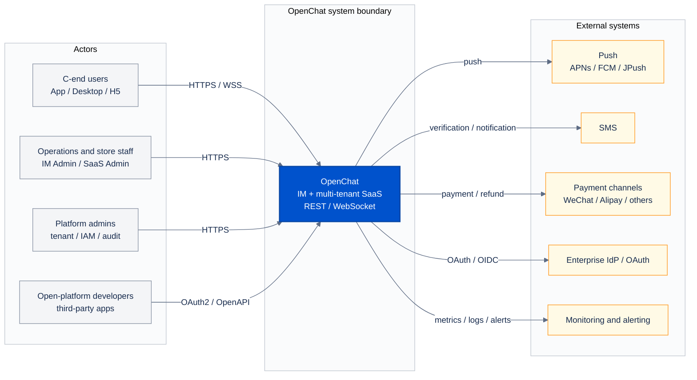

# 01 System Context

[中文](01-system-context.md) | [English](01-system-context.en.md)

> Diagram revision: `2026-10-21` · C4 semantics / grouped layout

> View: C4 Level 1 — System Context  
> Answers: who uses OpenChat, and which external systems sit outside its boundary?  
> Does not answer: internal services, databases or class structure.

## Reading notes

- OpenChat is one system boundary; its internal IM, SaaS and shared services are in the [container diagram](02-container.en.md).
- C-end clients use HTTPS for REST and WSS for the IM long connection.
- Admin consoles and open-platform apps enter through the public edge; they do not connect to internal services directly.
- Object storage is an internal capability (MinIO plus `common-media-service`), not an external system.
- External systems are only cross-organisation dependencies; internal infrastructure such as Redis/MySQL stays out of this view.

## Boundary rules

1. External systems integrate over explicit protocols; no shared database.
2. Third-party apps use OpenAPI/OAuth, never direct internal-service access.
3. Push, SMS and payment failures need retry or degradation; they must not block the core business transaction.
4. Enterprise IdP is optional; the local account model must still run independently.

## Implementation

- Edge: [ingress.yaml](../../../k8s/local/ingress.yaml)
- Push: [PUSH_SETUP.md](../../60-deployment/PUSH_SETUP.md)
- Open-platform contracts: [contracts](../../30-reference/contracts/README.md)
