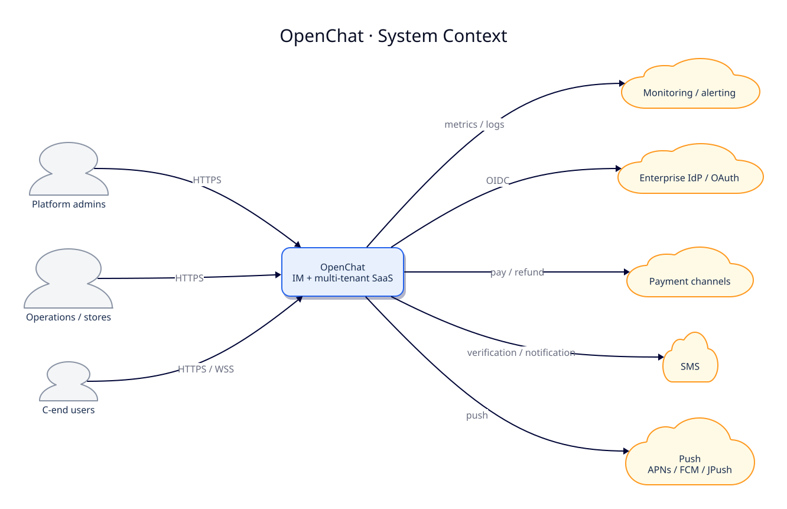

# 01 系统上下文图

[中文](01-system-context.md) | [English](01-system-context.en.md)

> 图版本：`2026-10-21` · C4 语义 / 分组布局

> 视角：C4 Level 1 — System Context  
> 回答：谁在使用 OpenChat？系统边界外有哪些外部系统？  
> 不回答：内部服务、数据库、类结构。

> 图源：[D2](src/01-system-context.d2) · 主题：D2 5

## 读图要点

- OpenChat 是一个系统边界，内部由 IM 域、SaaS 平台域和公共能力域组成；内部拆分见 [容器图](02-container.md)。
- C 端通过 HTTPS 调 REST，通过 WSS 保持 IM 长连接。
- 运营后台、SaaS 后台、开放平台都从统一入口进入，不直连内部服务。
- 对象存储是**系统内部能力**（MinIO + `common-media-service`），不画成外部系统。
- 外部系统只画真正跨组织边界的依赖，不把 Redis/MySQL 这类内部基础设施放进上下文图。

## 边界规则

1. 外部系统只通过明确协议接入，不共享数据库。
2. 第三方应用通过 OpenAPI/OAuth，不直接访问内部服务。
3. 推送、短信、支付失败必须有降级或重试，不阻塞主业务事务。
4. 企业 IdP 是可选能力；本地账号体系仍可独立运行。

## 相关实现

- 统一入口：[ingress.yaml](../../../k8s/local/ingress.yaml)
- 推送：[PUSH_SETUP.md](../../60-deployment/PUSH_SETUP.md)
- 开放平台契约：[contracts](../../30-reference/contracts/README.md)
