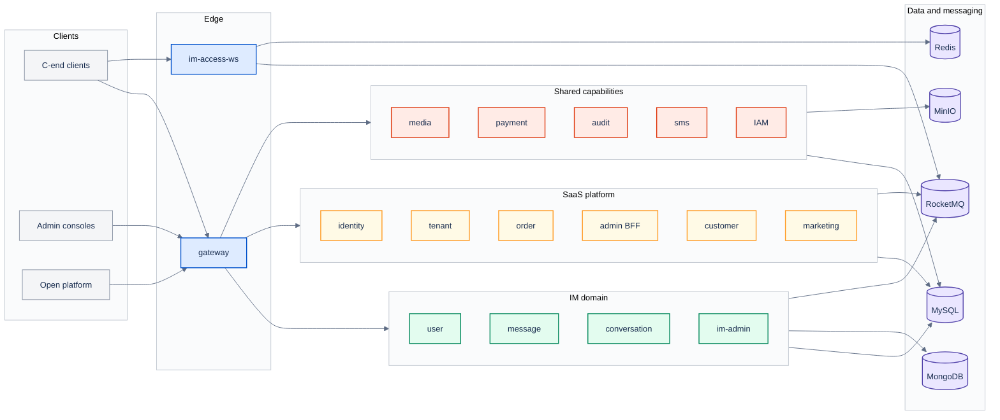

# 02 Container Diagram

[中文](02-container.md) | [English](02-container.en.md)

> View: C4 Level 2 — Container  
> Answers: which deployable units exist, what do they own, and how do they communicate?  
> Does not answer: pod replicas, nodes or table schemas.

## Reading notes

- Clients only reach Ingress. Gateway handles REST routing and auth pass-through; `im-access-ws` owns WebSocket connections.
- `im-message-service` is the authority for message writes: MySQL transaction plus Outbox; MongoDB/Redis are projections and caches.
- `im-access-ws` does not write business tables; it produces commands, consumes events and pushes to clients.
- `platform-admin-service` is a BFF aggregating identity/tenant capabilities; it does not own business data.
- `common-*` provides shared capabilities and never depends back on IM/SaaS domains.
- Ports and replicas follow the [K8s manifests](../../../k8s/local/applications.yaml).

## Services and ports

The diagram uses short names; full service names and local ports:

| Diagram label | Service | Port |
| --- | --- | --- |
| `user` | `im-user-service` | `3100` |
| `message` | `im-message-service` | `3200` |
| `conversation` | `im-conversation-service` | `3300` |
| `im-admin` | `im-admin-service` | `3400` |
| `identity` | `platform-identity-service` | `4100` |
| `tenant` | `platform-tenant-service` | `4110` |
| `order` | `platform-order-service` | `4130` |
| `admin BFF` | `platform-admin-service` | `4150` |
| `customer` | `platform-customer-service` | `4160` |
| `marketing` | `platform-marketing-service` | `4170` |
| `media` | `common-media-service` | `3600` |
| `payment` | `common-payment-service` | `4140` |
| `audit` | `common-audit-service` | `4190` |
| `sms` | `common-sms-service` | `4200` |
| `IAM` | `group-idaas-service` | `4220` |
| `gateway` | `gateway` | `3002` |
| `im-access-ws` | `im-access-ws` | `3001` |

## Protocols

| Path | Protocol |
| --- | --- |
| Client → Ingress / Gateway | HTTPS |
| Client → im-access-ws | WSS |
| Gateway → services | HTTP |
| Services → RocketMQ | RocketMQ client |
| Services → MySQL / Redis / MongoDB | native protocols |
| Services → MinIO | S3 API |

## Related

- [Deployment](03-deployment.en.md)
- [Data ownership](04-data-ownership.en.md)
- [Message send sequence](06-message-send-sequence.en.md)
