# 02 Container Diagram

[中文](02-container.md) | [English](02-container.en.md)

> View: C4 Level 2 — Container  
> Answers: which deployable units exist, what do they own, and how do they communicate?  
> Does not answer: pod replicas, nodes or table schemas.

```mermaid
flowchart TB
  subgraph Clients["Clients"]
    APP["open-chat-app<br/>Android / iOS / Web"]
    DESK["open-chat-desktop"]
    H5["open-saas-mobile<br/>C-end / B-end H5"]
    IMADMIN["open-chat-admin<br/>pc-admin"]
    SAASADMIN["open-saas-admin"]
    WEB["open-website"]
  end

  subgraph Edge["Edge"]
    ING["ingress-nginx"]
    GW["gateway<br/>:3002"]
    WS["im-access-ws<br/>:3001"]
  end

  subgraph IM["IM domain"]
    USER["im-user-service<br/>:3100"]
    MSG["im-message-service<br/>:3200"]
    CONV["im-conversation-service<br/>:3300"]
    IMADM["im-admin-service<br/>:3400"]
  end

  subgraph Platform["SaaS platform"]
    ID["platform-identity-service<br/>:4100"]
    TEN["platform-tenant-service<br/>:4110"]
    RES["platform-resource-service<br/>:4120"]
    ORD["platform-order-service<br/>:4130"]
    PADM["platform-admin-service<br/>BFF :4150"]
    CUS["platform-customer-service<br/>:4160"]
    MKT["platform-marketing-service<br/>:4170"]
  end

  subgraph Common["Shared capabilities"]
    MEDIA["common-media-service<br/>:3600"]
    PAY["common-payment-service<br/>:4140"]
    PAYCH["common-payment-channel-service<br/>:4180"]
    AUD["common-audit-service<br/>:4190"]
    SMS["common-sms-service<br/>:4200"]
    MAIL["common-mail-service<br/>:4210"]
    IDAAS["group-idaas-service<br/>:4220"]
  end

  subgraph Data["Data and messaging"]
    MYSQL[("MySQL<br/>open_im / open_saas<br/>open_group / open_audit")]
    REDIS[("Redis<br/>session / presence / cache")]
    MONGO[("MongoDB<br/>im_chat projection")]
    MQ[("RocketMQ<br/>commands / events")]
    MINIO[("MinIO<br/>media objects")]
  end

  APP --> ING
  DESK --> ING
  H5 --> ING
  IMADMIN --> ING
  SAASADMIN --> ING
  WEB --> ING
  ING --> GW
  ING --> WS
  ING --> IMADMIN
  ING --> SAASADMIN
  ING --> H5
  ING --> WEB

  GW --> USER
  GW --> MSG
  GW --> CONV
  GW --> IMADM
  GW --> ID
  GW --> TEN
  GW --> RES
  GW --> ORD
  GW --> PADM
  GW --> CUS
  GW --> MKT
  GW --> MEDIA
  GW --> PAY
  GW --> PAYCH
  GW --> AUD
  GW --> SMS
  GW --> MAIL
  GW --> IDAAS

  WS --> MQ
  WS --> REDIS
  WS --> USER
  WS --> CONV

  USER --> MYSQL
  USER --> MQ
  MSG --> MYSQL
  MSG --> MONGO
  MSG --> REDIS
  MSG --> MQ
  CONV --> MYSQL
  CONV --> MQ
  IMADM --> MYSQL
  IMADM --> MQ

  ID --> MYSQL
  TEN --> MYSQL
  RES --> MYSQL
  RES --> MQ
  ORD --> MYSQL
  ORD --> MQ
  CUS --> MYSQL
  CUS --> MQ
  MKT --> MYSQL
  MKT --> MQ
  PADM -.->|"BFF aggregation"| ID
  PADM -.->|"BFF aggregation"| TEN

  MEDIA --> MYSQL
  MEDIA --> MINIO
  PAY --> MYSQL
  PAY --> MQ
  PAYCH --> MYSQL
  AUD --> MYSQL
  SMS --> MYSQL
  MAIL --> MYSQL
  IDAAS --> MYSQL
```

## Reading notes

- Clients only reach Ingress. Gateway handles REST routing and auth pass-through; `im-access-ws` owns WebSocket connections.
- `im-message-service` is the authority for message writes: MySQL transaction plus Outbox; MongoDB/Redis are projections and caches.
- `im-access-ws` does not write business tables; it produces commands, consumes events and pushes to clients.
- `platform-admin-service` is a BFF aggregating identity/tenant capabilities; it does not own business data.
- `common-*` provides shared capabilities and never depends back on IM/SaaS domains.
- Ports and replicas follow the [K8s manifests](../../../k8s/local/applications.yaml).

## Protocols

| Path | Protocol |
| --- | --- |
| Client → Ingress / Gateway | HTTPS |
| Client → im-access-ws | WSS |
| Gateway → services | HTTP |
| Services → RocketMQ | RocketMQ client |
| Services → MySQL / Redis / MongoDB | native protocols |
| Services → MinIO | S3 API |

## Related

- [Deployment](03-deployment.en.md)
- [Data ownership](04-data-ownership.en.md)
- [Message send sequence](06-message-send-sequence.en.md)
