# 02 容器图

[中文](02-container.md) | [English](02-container.en.md)

> 视角：C4 Level 2 — Container  
> 回答：系统由哪些可部署单元组成？它们的职责、协议和依赖是什么？  
> 不回答：Pod 副本、Node、数据库表结构。

```mermaid
flowchart TB
  subgraph Clients["客户端"]
    APP["open-chat-app<br/>Android / iOS / Web"]
    DESK["open-chat-desktop"]
    H5["open-saas-mobile<br/>C 端 / B 端 H5"]
    IMADMIN["open-chat-admin<br/>pc-admin"]
    SAASADMIN["open-saas-admin"]
    WEB["open-website"]
  end

  subgraph Edge["接入层"]
    ING["ingress-nginx"]
    GW["gateway<br/>:3002"]
    WS["im-access-ws<br/>:3001"]
  end

  subgraph IM["IM 业务域"]
    USER["im-user-service<br/>:3100"]
    MSG["im-message-service<br/>:3200"]
    CONV["im-conversation-service<br/>:3300"]
    IMADM["im-admin-service<br/>:3400"]
  end

  subgraph Platform["SaaS 平台域"]
    ID["platform-identity-service<br/>:4100"]
    TEN["platform-tenant-service<br/>:4110"]
    RES["platform-resource-service<br/>:4120"]
    ORD["platform-order-service<br/>:4130"]
    PADM["platform-admin-service<br/>BFF :4150"]
    CUS["platform-customer-service<br/>:4160"]
    MKT["platform-marketing-service<br/>:4170"]
  end

  subgraph Common["公共能力域"]
    MEDIA["common-media-service<br/>:3600"]
    PAY["common-payment-service<br/>:4140"]
    PAYCH["common-payment-channel-service<br/>:4180"]
    AUD["common-audit-service<br/>:4190"]
    SMS["common-sms-service<br/>:4200"]
    MAIL["common-mail-service<br/>:4210"]
    IDAAS["group-idaas-service<br/>:4220"]
  end

  subgraph Data["数据与消息基础设施"]
    MYSQL[("MySQL<br/>open_im / open_saas<br/>open_group / open_audit")]
    REDIS[("Redis<br/>会话 / 在线 / 缓存")]
    MONGO[("MongoDB<br/>im_chat 消息投影")]
    MQ[("RocketMQ<br/>命令 / 事件")]
    MINIO[("MinIO<br/>媒体对象")]
  end

  APP --> ING
  DESK --> ING
  H5 --> ING
  IMADMIN --> ING
  SAASADMIN --> ING
  WEB --> ING
  ING --> GW
  ING --> WS
  ING --> IMADMIN
  ING --> SAASADMIN
  ING --> H5
  ING --> WEB

  GW --> USER
  GW --> MSG
  GW --> CONV
  GW --> IMADM
  GW --> ID
  GW --> TEN
  GW --> RES
  GW --> ORD
  GW --> PADM
  GW --> CUS
  GW --> MKT
  GW --> MEDIA
  GW --> PAY
  GW --> PAYCH
  GW --> AUD
  GW --> SMS
  GW --> MAIL
  GW --> IDAAS

  WS --> MQ
  WS --> REDIS
  WS --> USER
  WS --> CONV

  USER --> MYSQL
  USER --> MQ
  MSG --> MYSQL
  MSG --> MONGO
  MSG --> REDIS
  MSG --> MQ
  CONV --> MYSQL
  CONV --> MQ
  IMADM --> MYSQL
  IMADM --> MQ

  ID --> MYSQL
  TEN --> MYSQL
  RES --> MYSQL
  RES --> MQ
  ORD --> MYSQL
  ORD --> MQ
  CUS --> MYSQL
  CUS --> MQ
  MKT --> MYSQL
  MKT --> MQ
  PADM -.->|"BFF 聚合"| ID
  PADM -.->|"BFF 聚合"| TEN

  MEDIA --> MYSQL
  MEDIA --> MINIO
  PAY --> MYSQL
  PAY --> MQ
  PAYCH --> MYSQL
  AUD --> MYSQL
  SMS --> MYSQL
  MAIL --> MYSQL
  IDAAS --> MYSQL
```

## 读图要点

- 客户端只访问 Ingress；Gateway 负责 REST 路由和鉴权透传，`im-access-ws` 负责 WebSocket 长连接。
- IM 消息的权威写入是 `im-message-service`：MySQL 事务 + Outbox，MongoDB/Redis 只是投影与缓存。
- `im-access-ws` 不直接写业务表，只生产消息命令、消费事件并下行。
- `platform-admin-service` 是 BFF，聚合身份/租户等能力，不拥有独立业务数据。
- `common-*` 只提供公共能力，不反向依赖 IM/SaaS 业务域。
- 完整端口与副本以 [K8s 清单](../../../k8s/local/applications.yaml) 为准。

## 协议

| 路径 | 协议 |
| --- | --- |
| 客户端 → Ingress / Gateway | HTTPS |
| 客户端 → im-access-ws | WSS |
| Gateway → 业务服务 | HTTP |
| 服务 → RocketMQ | RocketMQ 客户端 |
| 服务 → MySQL / Redis / MongoDB | 各自原生协议 |
| 服务 → MinIO | S3 API |

## 相关文档

- [部署拓扑](03-deployment.md)
- [数据归属](04-data-ownership.md)
- [消息发送时序](06-message-send-sequence.md)
