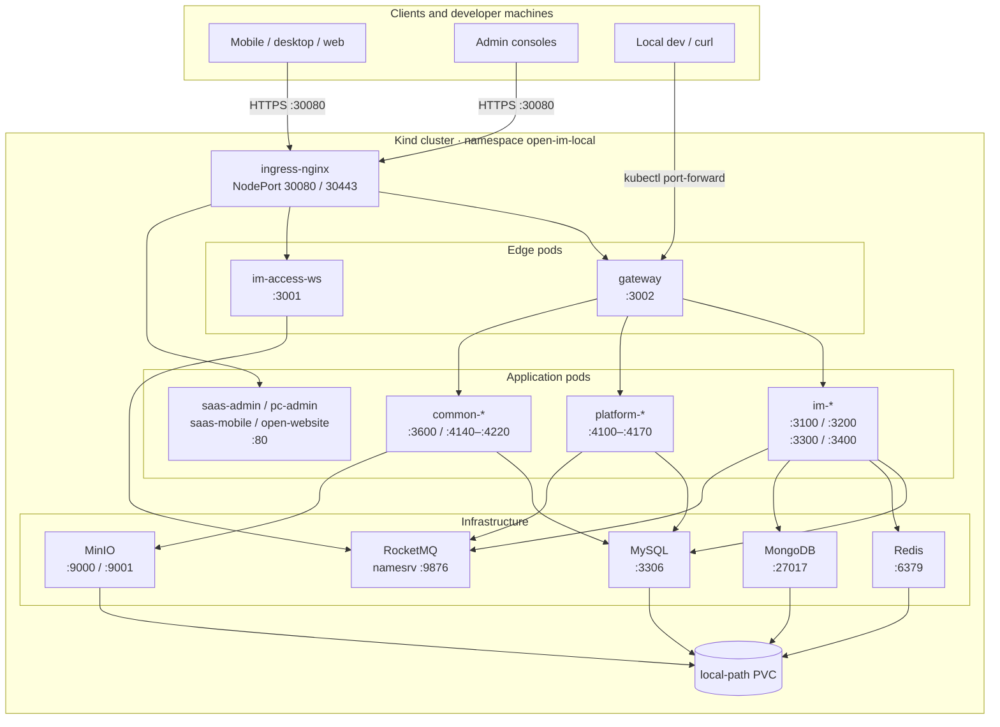

# 03 Deployment Topology

[中文](03-deployment.md) | [English](03-deployment.en.md)

> View: Deployment  
> Answers: where containers run, how the edge, namespace, ports, storage and dependencies connect.  
> Default: Kind local environment `open-im-local`; ACK changes edge/infrastructure implementations, not logical service boundaries.

## Ports and namespace

| Object | Port / address | Source |
| --- | --- | --- |
| `ingress-nginx` | `30080` HTTP / `30443` HTTPS (Kind NodePort) | `k8s/local/ingress.yaml` |
| `gateway` | `3002` | `k8s/local/applications.yaml` |
| `im-access-ws` | `3001` | same |
| `im-user-service` | `3100` | same |
| `im-message-service` | `3200` | same |
| `im-conversation-service` | `3300` | same |
| `im-admin-service` | `3400` | same |
| `platform-identity-service` | `4100` | same |
| `platform-tenant-service` | `4110` | same |
| `platform-resource-service` | `4120` | same |
| `platform-order-service` | `4130` | same |
| `platform-admin-service` | `4150` | same |
| `platform-customer-service` | `4160` | same |
| `platform-marketing-service` | `4170` | same |
| `common-media-service` | `3600` | same |
| `common-payment-service` | `4140` | same |
| `common-payment-channel-service` | `4180` | same |
| `common-audit-service` | `4190` | same |
| `common-sms-service` | `4200` | same |
| `common-mail-service` | `4210` | same |
| `group-idaas-service` | `4220` | same |
| MySQL / Redis / MongoDB | `3306` / `6379` / `27017` | `k8s/local/infrastructure.yaml` |
| RocketMQ | namesrv `9876` | same |
| MinIO | API `9000` / console `9001` | same |

## Reading notes

- All application pods run in `open-im-local`; services communicate through Kubernetes Service DNS.
- Only Ingress is exposed to the host; internal Services stay `ClusterIP`.
- `minio` uses `NodePort` locally; production should use an internal service plus object-storage gateway.
- `local-path` PVC is local-only; production needs a replicated, backed-up StorageClass.
- Pods of the same class are grouped here; the K8s files are authoritative.

## Related

- [Local deployment](../../60-deployment/LOCAL.md)
- [Docker Compose](../../60-deployment/DOCKER.md)
- [ACK deployment](../../60-deployment/ACK.md)
- [Container diagram](02-container.en.md)
