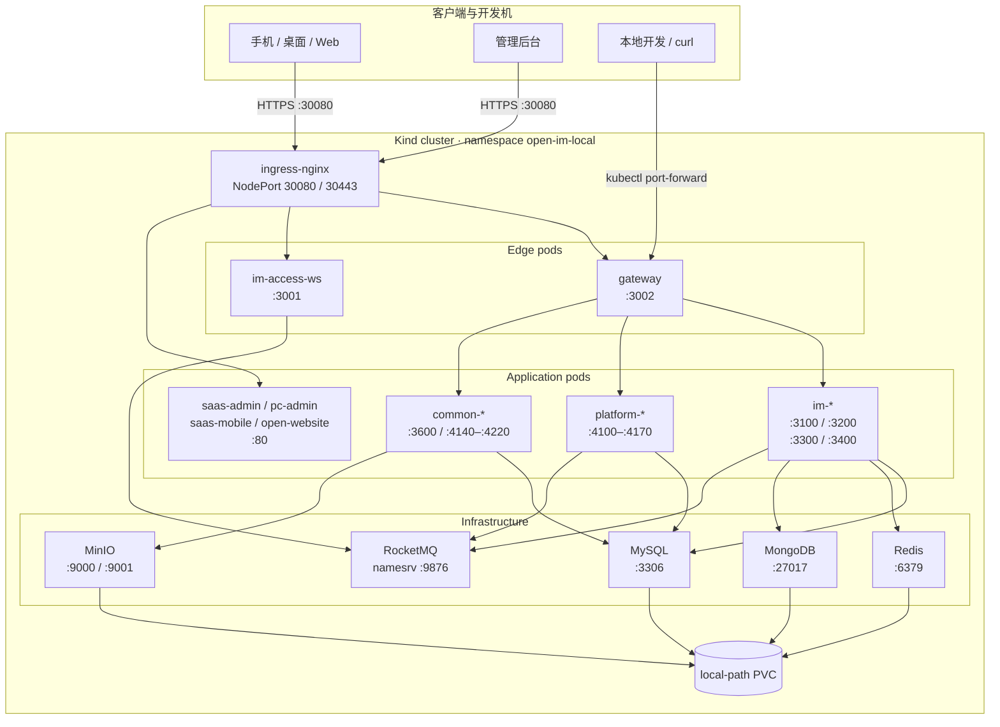

# 03 部署拓扑

[中文](03-deployment.md) | [English](03-deployment.en.md)

> 视角：Deployment  
> 回答：容器实际跑在哪里？入口、命名空间、端口、存储和依赖怎么连？  
> 默认示例：Kind 本地环境 `open-im-local`；ACK 只替换入口和基础设施实现，不改变逻辑服务边界。

## 端口与命名空间

| 对象 | 端口 / 地址 | 来源 |
| --- | --- | --- |
| `ingress-nginx` | `30080` HTTP / `30443` HTTPS（Kind NodePort） | `k8s/local/ingress.yaml` |
| `gateway` | `3002` | `k8s/local/applications.yaml` |
| `im-access-ws` | `3001` | 同上 |
| `im-user-service` | `3100` | 同上 |
| `im-message-service` | `3200` | 同上 |
| `im-conversation-service` | `3300` | 同上 |
| `im-admin-service` | `3400` | 同上 |
| `platform-identity-service` | `4100` | 同上 |
| `platform-tenant-service` | `4110` | 同上 |
| `platform-resource-service` | `4120` | 同上 |
| `platform-order-service` | `4130` | 同上 |
| `platform-admin-service` | `4150` | 同上 |
| `platform-customer-service` | `4160` | 同上 |
| `platform-marketing-service` | `4170` | 同上 |
| `common-media-service` | `3600` | 同上 |
| `common-payment-service` | `4140` | 同上 |
| `common-payment-channel-service` | `4180` | 同上 |
| `common-audit-service` | `4190` | 同上 |
| `common-sms-service` | `4200` | 同上 |
| `common-mail-service` | `4210` | 同上 |
| `group-idaas-service` | `4220` | 同上 |
| MySQL / Redis / MongoDB | `3306` / `6379` / `27017` | `k8s/local/infrastructure.yaml` |
| RocketMQ | namesrv `9876` | 同上 |
| MinIO | API `9000` / console `9001` | 同上 |

## 读图要点

- 所有应用 Pod 在 `open-im-local` 命名空间；服务之间用 Kubernetes Service DNS 通信。
- 只有 Ingress 暴露到宿主机；内部 Service 保持 `ClusterIP`。
- `minio` 在本地 Kind 使用 `NodePort`；生产应改为内部 Service + 对象存储网关。
- `local-path` PVC 只适合本地；生产必须换成有副本和备份的 StorageClass。
- 上图把同类 Pod 合并展示，精确清单以 K8s 文件为准。

## 相关文档

- [本地部署](../../60-deployment/LOCAL.md)
- [Docker Compose](../../60-deployment/DOCKER.md)
- [ACK 部署](../../60-deployment/ACK.md)
- [容器图](02-container.md)
