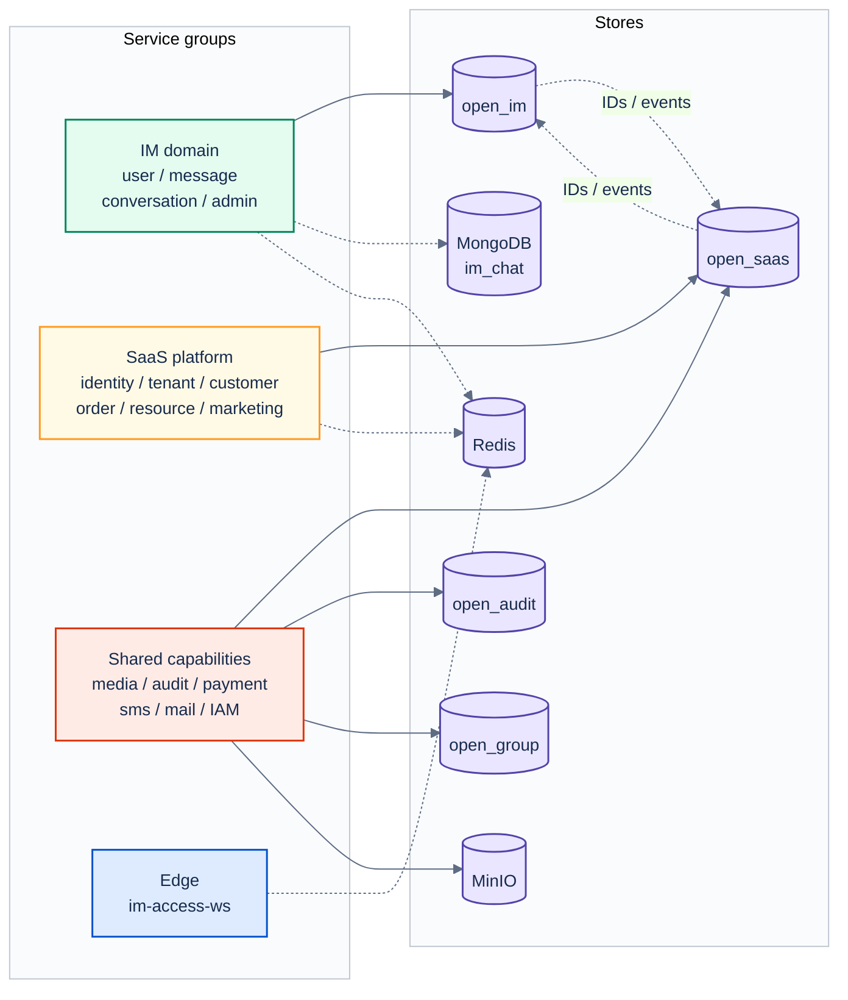

# 04 Data Ownership

[中文](04-data-ownership.md) | [English](04-data-ownership.en.md)

> Diagram revision: `2026-10-21` · C4 semantics / grouped layout

> View: Data Ownership  
> Answers: which service owns which data, what crosses boundaries, and which stores are not authoritative.  
> Does not answer: full ER models; exact columns follow each service's Flyway.

## Ownership table

| Store | Authoritative owner | Core data | Rule |
| --- | --- | --- | --- |
| MySQL `open_im` | `im-user-service`, `im-message-service`, `im-conversation-service` | users/friends/devices, messages/read/recall, conversations/groups | table-prefix ownership inside IM; no cross-domain writes |
| MySQL `open_saas` | `platform-identity/tenant/customer/order/resource/marketing` plus shared payment config | accounts, tenants, customers, orders, resources, marketing, payment config | aggregate ownership inside SaaS; BFF is read-only |
| MySQL `open_audit` | `common-audit-service` | audit events | append-only; never the source of business state |
| MySQL `open_group` | `group-idaas-service` | group IAM | written only by IAM |
| MongoDB `im_chat` | `im-message-service` | message hot projection, offline inbox | **projection, never authority**; rebuildable |
| Redis | each consumer | sessions, presence, cache, cross-instance coordination | **cache, never authority**; rebuildable |
| MinIO | `common-media-service` | image/file objects | metadata in MySQL; bytes in MinIO |

## Reading notes

- One MySQL instance may host multiple schemas, but **one table has exactly one owner**.
- Cross-service communication uses IDs or events; no cross-schema JOIN, foreign key or direct UPDATE.
- `im-admin-service` and `platform-admin-service` are read models/BFFs; they do not own core business tables.
- MySQL is the source of truth for messages; MongoDB and Redis are projections/caches only.
- Media metadata and binary objects are split: MySQL stores references/state, MinIO stores bytes.

## Related

- [Engineering topology](../TOPOLOGY.en.md)
- [DDD conventions](../../80-development/standards/10_DDD_SERVICE_ENGINEERING_CONVENTIONS.en.md)
- [Persistence stack](../../80-development/standards/21_PERSISTENCE_STACK.en.md)
- [MQ registry](../../30-reference/mq/REGISTRY.md)
