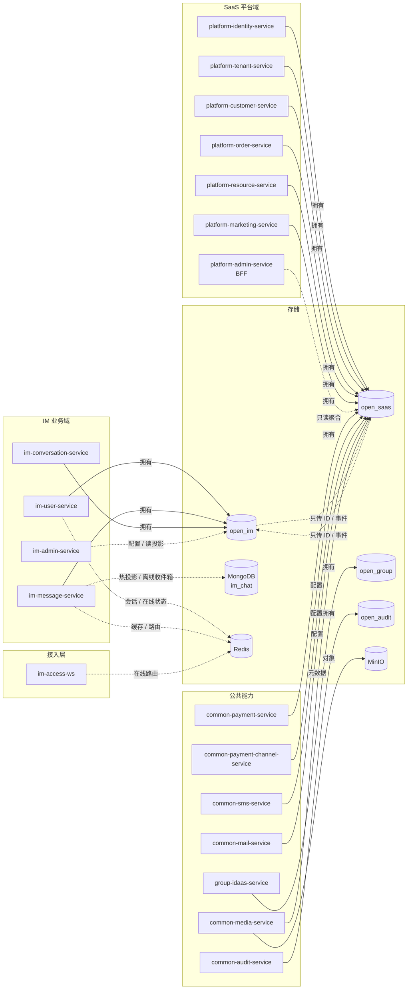

# 04 数据归属图

[中文](04-data-ownership.md) | [English](04-data-ownership.en.md)

> 视角：Data Ownership  
> 回答：哪类数据由哪个服务拥有？跨服务共享了什么？哪些存储不是权威事实？  
> 不回答：完整 ER 图；精确字段以各服务 Flyway 为准。

## 归属表

| 存储 | 权威 Owner | 核心数据 | 规则 |
| --- | --- | --- | --- |
| MySQL `open_im` | `im-user-service`、`im-message-service`、`im-conversation-service` | 用户/好友/设备、消息/已读/撤回、会话/群组 | IM 域内按表前缀分 Owner，不跨域写表 |
| MySQL `open_saas` | `platform-identity/tenant/customer/order/resource/marketing` + 公共支付配置 | 账号/租户/客户/订单/资源/营销/支付配置 | 平台域内按聚合分 Owner；BFF 只读 |
| MySQL `open_audit` | `common-audit-service` | 审计事件 | 只追加，不反向承载业务状态 |
| MySQL `open_group` | `group-idaas-service` | 集团 IAM | 只由 IAM 域写入 |
| MongoDB `im_chat` | `im-message-service` | 消息热投影、离线收件箱 | **投影，不是权威事实**，可重建 |
| Redis | 各使用方 | 会话、在线状态、缓存、跨实例协同 | **缓存，不是权威事实**，可重建 |
| MinIO | `common-media-service` | 图片/文件对象 | 元数据在 MySQL，对象在 MinIO |

## 读图要点

- 一个 MySQL 实例可以有多个 schema，但**一个表只有一个 Owner**。
- 跨服务只允许传 ID 或事件，不允许跨 schema JOIN/外键/直接 UPDATE。
- `im-admin-service`、`platform-admin-service` 是读模型/BFF，不拥有核心业务表。
- 消息以 MySQL 为准；MongoDB 和 Redis 只能作为投影/缓存，丢了可以从权威数据重建。
- 媒体元数据与对象分离：MySQL 存引用和状态，MinIO 存二进制。

## 相关文档

- [工程拓扑](../TOPOLOGY.zh.md)
- [DDD 服务工程规范](../../80-development/standards/10_DDD_SERVICE_ENGINEERING_CONVENTIONS.md)
- [持久层标准](../../80-development/standards/21_PERSISTENCE_STACK.md)
- [MQ 台账](../../30-reference/mq/REGISTRY.md)
