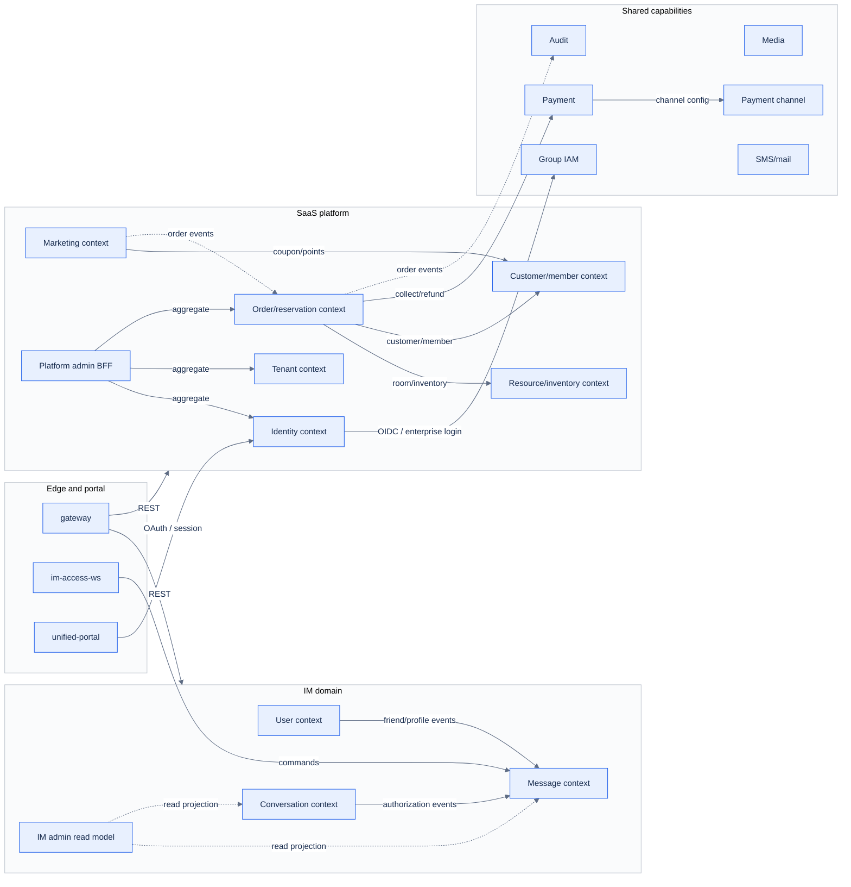

# 05 Bounded Context Map

[中文](05-context-map.md) | [English](05-context-map.en.md)

> Diagram revision: `2026-10-21` · C4 semantics / grouped layout

> View: DDD Context Map  
> Answers: which bounded contexts exist, who depends on whom, and how they collaborate.  
> Does not answer: deployment replicas or table schemas.

## Relationships

| Upstream | Downstream | Relationship | Rule |
| --- | --- | --- | --- |
| Gateway / WS | IM, SaaS | sync API / commands | edge handles protocol and auth, not domain rules |
| User, conversation | Message | domain events | friend/conversation changes project into messaging |
| Order/reservation | Resource, customer, payment, audit | sync API / events | order never writes their tables |
| Platform admin BFF | identity, tenant, order | aggregate query | BFF owns no core business data |
| Identity | Group IAM | OIDC/OAuth | enterprise IdP is optional; local accounts fall back |
| IM / SaaS | shared capabilities | API / events | shared capabilities never depend back on domains |

## Boundary rules

1. Contexts collaborate through APIs or events; no shared tables or cross-schema joins.
2. Order orchestrates reservation/session flows but is not the owner of resource, customer or payment data.
3. The IM admin read model is projection-only; it is not a writer of IM business facts.
4. Shared capabilities are downstream; they must not depend on IM/SaaS domains.
5. The edge is an adapter, not a business orchestration layer.

## Related

- [DDD conventions](../../80-development/standards/10_DDD_SERVICE_ENGINEERING_CONVENTIONS.en.md)
- [Data ownership](04-data-ownership.en.md)
- [Service catalog](../../50-services/README.en.md)
