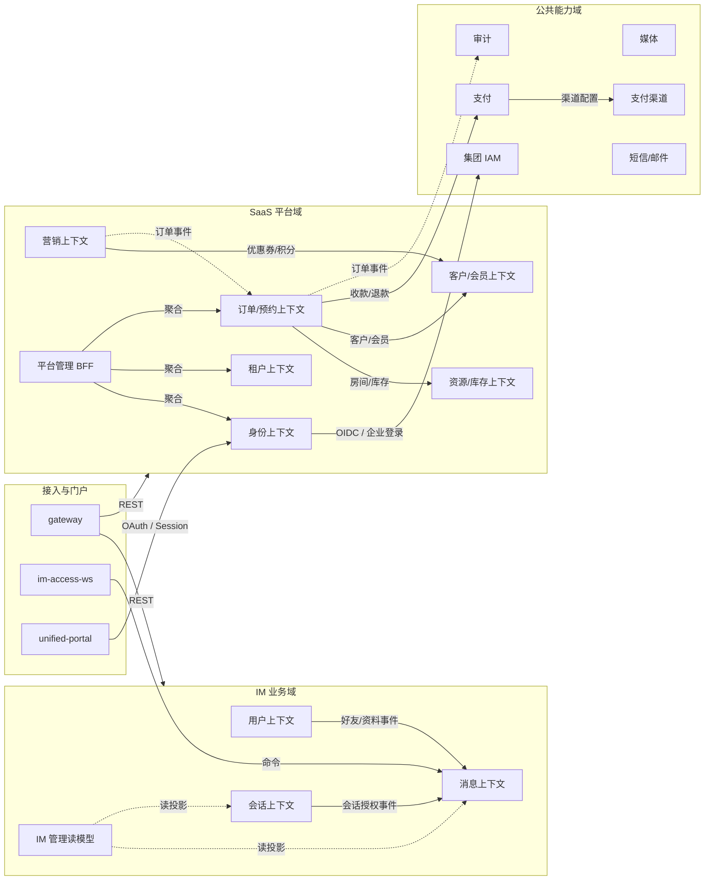

# 05 限界上下文图

[中文](05-context-map.md) | [English](05-context-map.en.md)

> 视角：DDD Context Map  
> 回答：有哪些限界上下文？谁依赖谁？跨上下文通过什么协作？  
> 不回答：部署副本、数据库表结构。

## 上下文关系

| 上游 | 下游 | 关系 | 规则 |
| --- | --- | --- | --- |
| Gateway / WS | IM、SaaS | 同步 API / 命令 | 接入层只做协议与鉴权，不承载领域规则 |
| 用户、会话 | 消息 | 领域事件 | 好友/会话变更通过事件驱动消息侧投影 |
| 订单/预约 | 资源、客户、支付、审计 | 同步 API / 事件 | 订单不直接写资源/客户/支付表 |
| 平台管理 BFF | 身份、租户、订单 | 聚合查询 | BFF 不拥有核心业务数据 |
| 身份 | 集团 IAM | OIDC/OAuth | 企业 IdP 可选，本地账号兜底 |
| IM / SaaS | 公共能力 | API / 事件 | 公共能力不得反向依赖具体业务域 |

## 边界规则

1. 上下文之间只通过 API 或事件协作，不共享表、不跨库 JOIN。
2. 订单是预约/开台的编排者，但不是资源、客户、支付数据的 Owner。
3. IM 管理读模型只读投影，不作为 IM 业务事实的写入方。
4. 公共能力是下游；不能被 IM/SaaS 反向依赖。
5. 接入层是边缘适配器，不能成为业务编排层。

## 相关文档

- [DDD 服务工程规范](../../80-development/standards/10_DDD_SERVICE_ENGINEERING_CONVENTIONS.md)
- [数据归属](04-data-ownership.md)
- [服务目录](../../50-services/README.md)
