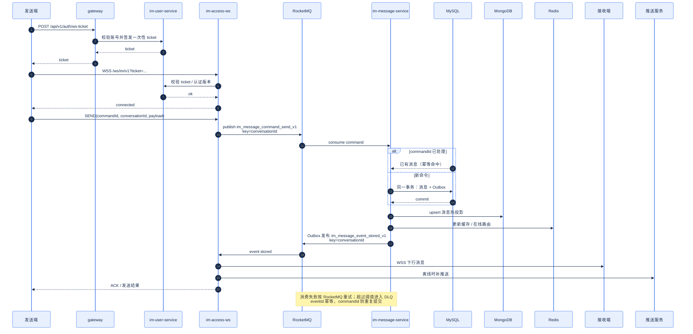

# 06 消息发送时序

[中文](06-message-send-sequence.md) | [English](06-message-send-sequence.en.md)

> 图版本：`2026-10-21` · C4 语义 / 分组布局

> 视角：Sequence  
> 回答：一条 IM 消息从客户端发出到接收方收到，经过哪些边界？  
> 重点：幂等、事务、Outbox、重试和离线补偿。

## 读图要点

| 边界 | 规则 |
| --- | --- |
| 客户端 → 接入层 | 先用一次性 WS ticket 建连，不在 URL 里长期放 access token |
| 接入层 → MQ | 只生产命令，不直接写消息表 |
| MQ → 消息服务 | `conversationId` 作为顺序键，`commandId` 作为幂等键 |
| 消息服务 → MySQL | 消息事实与 Outbox 在同一事务内提交 |
| 消息服务 → MongoDB/Redis | 投影/缓存，失败可重试，不是权威事实 |
| MQ → 接入层 | `eventId` 幂等，在线下行、离线推送 |
| 失败路径 | 重试 → DLQ；监控告警；不能静默丢消息 |

## 不变量

1. 消息权威事实只在 MySQL；MongoDB 不是 Source of Truth。
2. `commandId` 重复投递不得产生第二条消息。
3. `eventId` 重复消费不得重复下行或重复推送。
4. Outbox 未提交成功时，不能先发 MQ 事件。
5. 客户端 ACK 只表示接入层已接受，不代表所有接收方已读。

## 相关文档

- [MQ 台账](../../30-reference/mq/REGISTRY.md)
- [MQ 拓扑](07-mq-topology.md)
- [消息服务](../../50-services/im/im-message-service/README.md)
- [RocketMQ 规范](../../80-development/standards/12_ROCKETMQ_CONVENTIONS.md)
