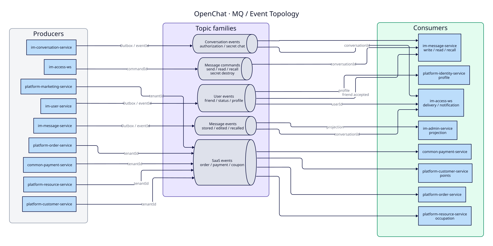

# 07 MQ / Event Topology

[中文](07-mq-topology.md) | [English](07-mq-topology.en.md)

> Diagram revision: `2026-10-21` · C4 semantics / grouped layout

> View: Event Flow  
> Answers: which event families exist, who produces/consumes them, and what are the ordering and idempotency keys.  
> Exact topics/consumer groups live in the [MQ registry](../../30-reference/mq/REGISTRY.md); this diagram groups by family.

> Source: [D2](src/07-mq-topology.d2) · theme: D2 5

## Ordering and idempotency

| Family | Ordering key | Idempotency key | Note |
| --- | --- | --- | --- |
| `im_message_command_*` | `conversationId` | `commandId` | command; duplicate submit must not create a second message |
| `im_message_event_*` | `conversationId` | `eventId` | fact event; downlink/projection must be idempotent |
| `im_user_event_*` | `userId` (friend accepted: requester/acceptor) | `eventId` (friend accepted also `requestId`) | status, friends, profile, purge, wipe |
| `im_conversation_event_*` | `conversationId` | `eventId` | authorization and secret-chat lifecycle |
| `ord_*` / `pay_*` / `mkt_*` / `cst_*` / `res_*` | `tenantId` | `eventId` | SaaS events isolated by tenant |

## Rules

1. **Outbox first**: business write and event record commit together; a relay publishes; no dual write.
2. **Consumer idempotency**: deduplicate by the registered key; a redelivery has one side effect.
3. **Ordering**: preserve order per `conversationId`/`tenantId`; no global ordering across keys.
4. **Failure**: retry then DLQ; alert and support manual replay.
5. **Payload**: IDs, versions and necessary metadata only; no sensitive plaintext in MQ.
6. **No cross-service DB reads**: consumers use APIs or their own projections.

## Related

- [MQ registry](../../30-reference/mq/REGISTRY.md)
- [RocketMQ conventions](../../80-development/standards/12_ROCKETMQ_CONVENTIONS.en.md)
- [Message send sequence](06-message-send-sequence.en.md)
