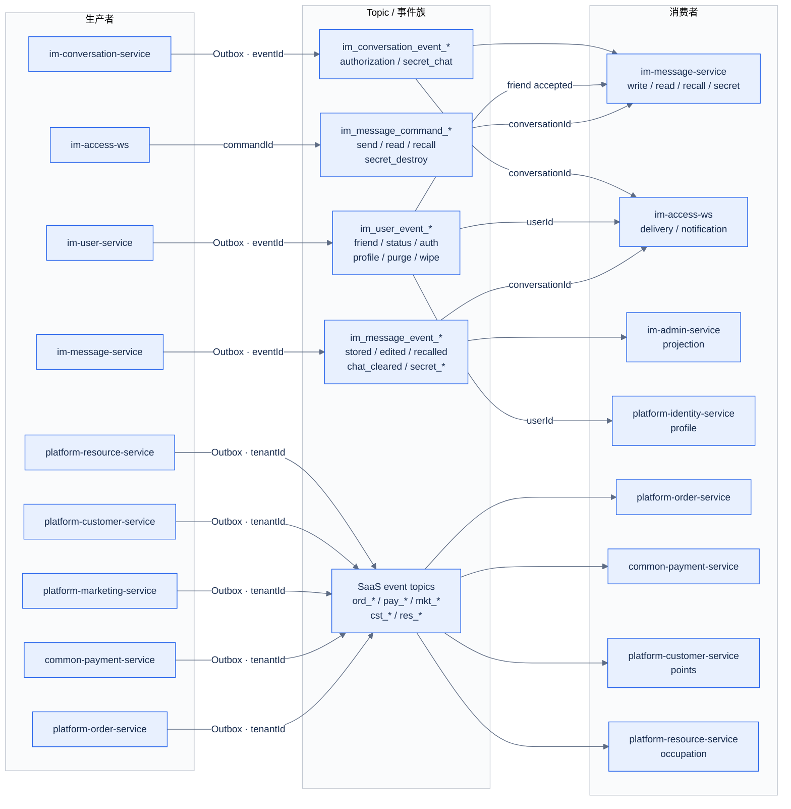

# 07 MQ / 事件拓扑

[中文](07-mq-topology.md) | [English](07-mq-topology.en.md)

> 视角：Event Flow  
> 回答：有哪些事件族？谁生产、谁消费？顺序键和幂等键是什么？  
> 精确 Topic/Consumer Group 清单见 [MQ 台账](../../30-reference/mq/REGISTRY.md)，本图按事件族聚合。

## 顺序键与幂等键

| 事件族 | 顺序键 | 幂等键 | 说明 |
| --- | --- | --- | --- |
| `im_message_command_*` | `conversationId` | `commandId` | 命令；重复提交不得产生第二条消息 |
| `im_message_event_*` | `conversationId` | `eventId` | 事实事件；下行/投影必须幂等 |
| `im_user_event_*` | `userId`（好友通过用申请方/同意方） | `eventId`（好友通过另用 `requestId`） | 用户状态、好友、资料、数据擦除 |
| `im_conversation_event_*` | `conversationId` | `eventId` | 会话授权、私密会话生命周期 |
| `ord_*` / `pay_*` / `mkt_*` / `cst_*` / `res_*` | `tenantId` | `eventId` | SaaS 域事件；按租户隔离 |

## 规则

1. **Outbox 优先**：业务写入与事件记录同事务，Relay 负责投递，不做双写。
2. **消费者幂等**：所有消费者按登记键去重；重复投递只能产生一次副作用。
3. **顺序**：同一 `conversationId`/`tenantId` 内保序；跨键不承诺全局顺序。
4. **失败**：重试后进入 DLQ，必须有告警和人工重放流程。
5. **事件内容**：只带 ID、版本和必要元数据，不把敏感明文塞进 MQ。
6. **禁止回查**：消费者不得跨服务直接读对方数据库；需要数据时通过 API 或事件投影。

## 相关文档

- [MQ 台账](../../30-reference/mq/REGISTRY.md)
- [RocketMQ 规范](../../80-development/standards/12_ROCKETMQ_CONVENTIONS.md)
- [消息发送时序](06-message-send-sequence.md)
