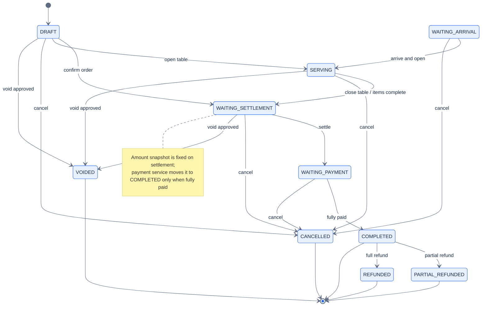
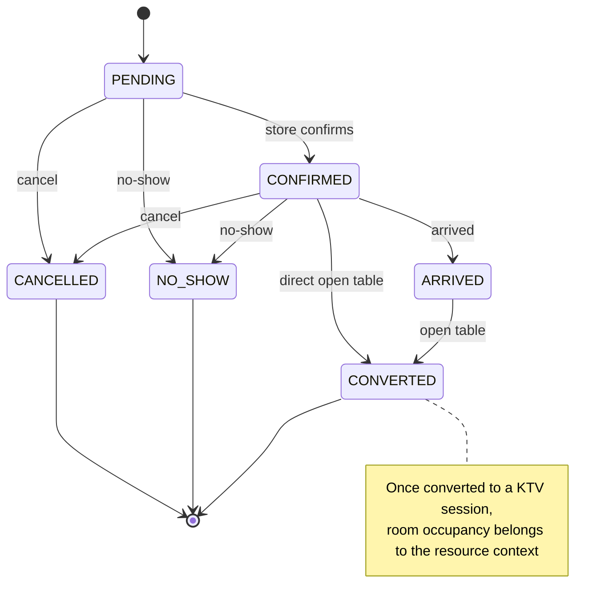
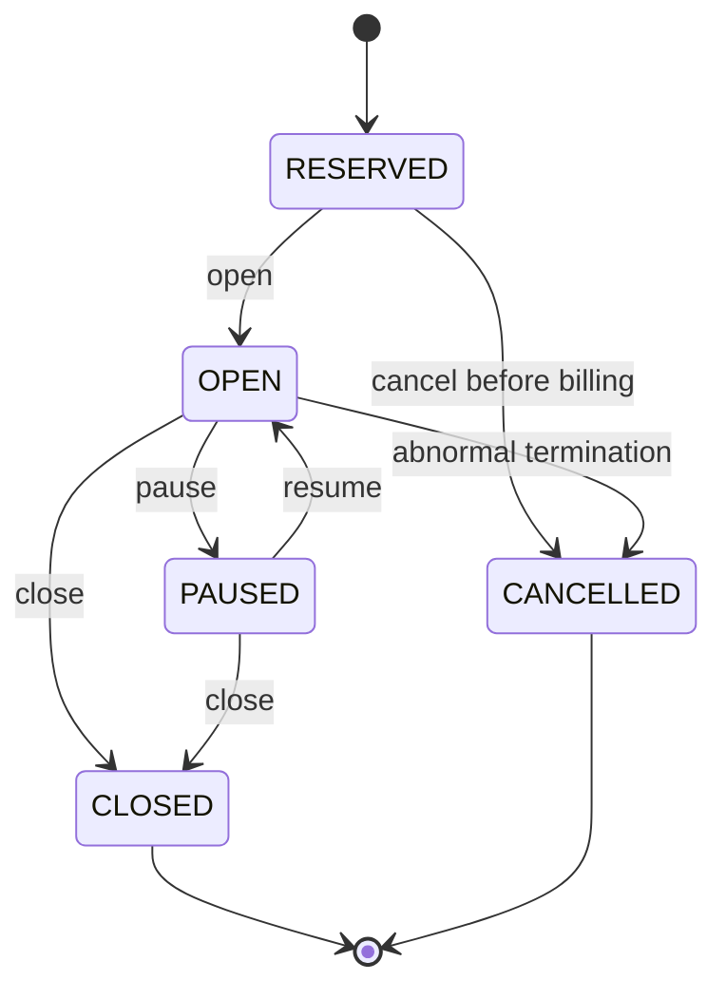

# 08 Order / Reservation / KTV State Machines

[中文](08-order-reservation-state.md) | [English](08-order-reservation-state.en.md)

> Diagram revision: `2026-10-21` · C4 semantics / grouped layout

> View: State Machine  
> Answers: which transitions are allowed for orders, reservations and KTV sessions, and which states are terminal.  
> State strings follow code and Flyway; this diagram does not replace business rule docs.

## 1. Order `ord_order`

### Order states

| State | Meaning | Terminal |
| --- | --- | --- |
| `DRAFT` | draft / to confirm | no |
| `WAITING_ARRIVAL` | waiting for arrival | no |
| `SERVING` | serving / table open | no |
| `WAITING_SETTLEMENT` | waiting for settlement | no |
| `WAITING_PAYMENT` | waiting for payment | no |
| `COMPLETED` | completed | yes |
| `CANCELLED` | cancelled | yes |
| `VOIDED` | voided | yes |
| `REFUNDED` | fully refunded | yes |
| `PARTIAL_REFUNDED` | partially refunded | yes |

## 2. Reservation `ktv_reservation`

### Reservation rules

- `PENDING` / `CONFIRMED` are pre-arrival: confirm, cancel, reschedule, mark no-show.
- `ARRIVED`: can open a table; cancellation must go through "cancel order" to avoid a dangling timed order.
- `CONVERTED`: reservation no longer occupies a reservation slot; room occupancy moves to the resource context.
- `CANCELLED` / `NO_SHOW` / `CONVERTED` are terminal.

## 3. KTV session `ord_ktv_session`

## Sources of truth

- Order: `platform-services/order/platform-order-service/.../domain/order/model/Order.java`
- Reservation: `.../domain/reservation/model/ReservationStatus.java`
- KTV session: `.../domain/ktv/model/KtvSession.java`
- Schema/comments: `.../src/main/resources/db/migration/V1__ord_order_baseline.sql`

## Related

- [Domain docs](../../40-domain/README.en.md)
- [Order service](../../50-services/platform/platform-order-service/README.en.md)
- [Database migration](../../80-development/standards/23_DATABASE_MIGRATION_STANDARD.en.md)
