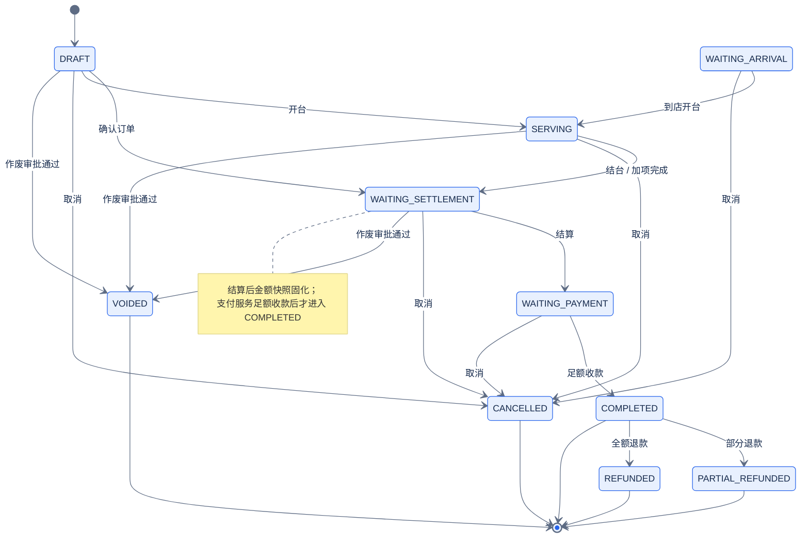
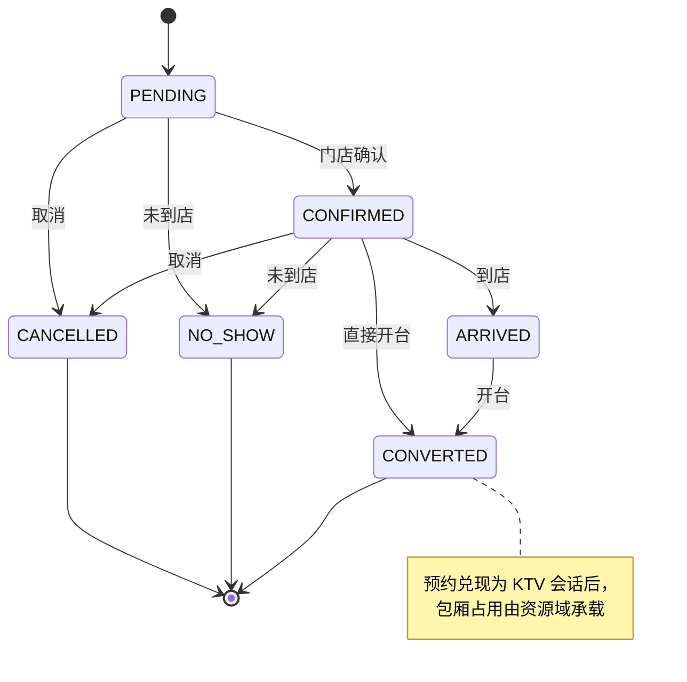
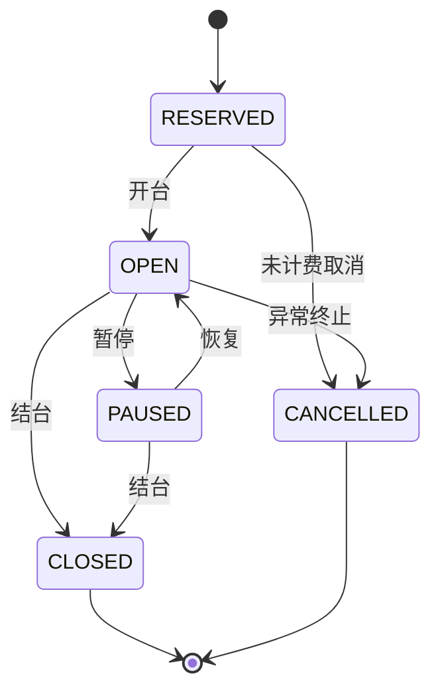

# 08 订单 / 预约 / 开台状态机

[中文](08-order-reservation-state.md) | [English](08-order-reservation-state.en.md)

> 图版本：`2026-10-21` · C4 语义 / 分组布局

> 视角：State Machine  
> 回答：订单、预约、KTV 会话允许哪些状态迁移？哪些是终态？  
> 状态字符串以代码和 Flyway 为准；本图不替代业务规则文档。

## 1. 订单 `ord_order`

### 订单状态说明

| 状态 | 含义 | 是否终态 |
| --- | --- | --- |
| `DRAFT` | 草稿/待确认 | 否 |
| `WAITING_ARRIVAL` | 待到店 | 否 |
| `SERVING` | 服务中/已开台 | 否 |
| `WAITING_SETTLEMENT` | 待结算 | 否 |
| `WAITING_PAYMENT` | 待收款 | 否 |
| `COMPLETED` | 已完成 | 是 |
| `CANCELLED` | 已取消 | 是 |
| `VOIDED` | 已作废 | 是 |
| `REFUNDED` | 已全额退款 | 是 |
| `PARTIAL_REFUNDED` | 已部分退款 | 是 |

## 2. 预约 `ord_reservation`

### 预约规则

- `PENDING` / `CONFIRMED` 属于到店前状态：可确认、取消、改期、标记未到店。
- `ARRIVED` 已到店：可开台；取消预约必须改走“取消订单”，避免订单仍在计时。
- `CONVERTED` 已开台：预约不再占用预约名额，包厢占用由资源域承载。
- `CANCELLED` / `NO_SHOW` / `CONVERTED` 是终态。

## 3. KTV 会话 `ord_ktv_session`

## 状态权威来源

- 订单：`platform-services/order/platform-order-service/.../domain/order/model/Order.java`
- 预约：`.../domain/reservation/model/ReservationStatus.java`
- KTV 会话：`.../domain/ktv/model/KtvSession.java`
- 建表与注释：`.../src/main/resources/db/migration/V1__ord_order_baseline.sql`

## 相关文档

- [领域文档](../../40-domain/README.md)
- [订单服务](../../50-services/platform/platform-order-service/README.md)
- [数据库迁移标准](../../80-development/standards/23_DATABASE_MIGRATION_STANDARD.md)
