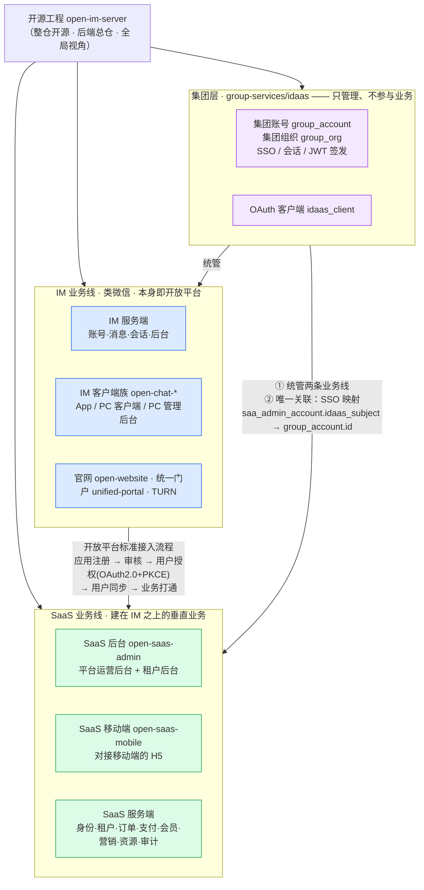
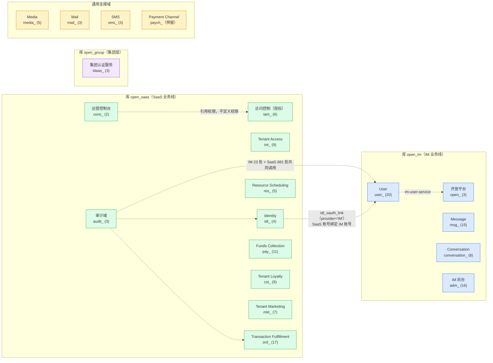
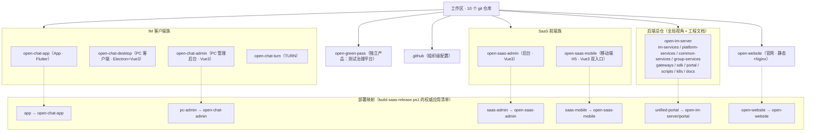
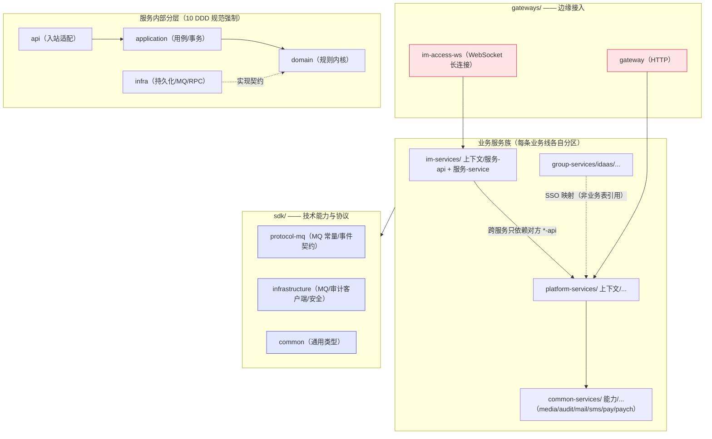
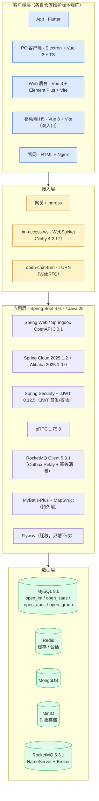

# 工程架构图集（Architecture Diagrams）

> **性质**：工程详细文档（属[项目事实清单](./PROJECT_FACTS_INVENTORY.md)同类的"工程实际长什么样"）。**四张图**：产品业务图、领域架构图、工程结构图、技术栈架构图。
> **维护**：与事实清单同步更新——**新增/变更业务线、域、服务、仓库、技术栈版本时，必须同步本图集**。
> **依据**：[ACCOUNT_PERMISSION_MODEL](./ACCOUNT_PERMISSION_MODEL.md)、[IM 开放平台方案](../archive/renovation/IM_OPEN_PLATFORM_01_SERVICE.md)、[SAAS_PLATFORM_09](../archive/renovation/SAAS_PLATFORM_09_SERVICE.md)、[技术栈版本矩阵](../standards/22_TECHNOLOGY_STACK_VERSION_MATRIX.md)、[工程规则](../ENGINEERING_RULES.md)。所有节点与库名均为实测。

---

## 一、产品业务图（三层层级与两条业务线）

**一句话**：**IM 是开放平台**（参考微信），**SaaS 是它的第一个第三方接入方**（"美团之于微信"），**集团层统管两者但只管理、不参与业务**。

**要点**（均有实测依据）：
- **IM 与 SaaS 互相引用，但各有权威**：SaaS 账号经 `idt_oauth_link`（`provider='IM'`）绑定 IM 账号。
- **集团 → SaaS 的唯一关联是 SSO 映射**（`saa_admin_account.idaas_subject` → `group_account.id`）；**业务表不引用集团 IDaaS 表**。
- ⚠️ **`idt_*` 是 SaaS 平台账号，不是 IDaaS**；IDaaS 是集团的 `group_account`。
- 第三方（打车 / 电商 / 本地生活）未来按**同一标准流程**接入，故本图不是"两个系统的集成"，而是**开放平台的第一个接入方**。

---

## 二、领域架构图（业务线 → 限界上下文 → 权威服务 → 库）

**判据**：表前缀 = 限界上下文；**一个前缀 = 一个域**；业务线由**代码根 + 库名**承载，**不写进表名**。

**关键说明**：
- **审计域是独立域**，被 IM（23 处）与 SaaS（881 处）**共同调用**；对外发布 `common-audit-api`，独立 schema `open_audit`、独立 Flyway history。**表已从 `iam_audit_*` 归位为 `audit_*`**（见[例行整改总纲](../archive/renovation/UNIFIED_NAMING_REMEDIATION_PLAN.md)）。
- **`iam_` 只做授权**（无 Identity Management）：角色/权限/作用域授权/审批；**身份**由 `idt_`（SaaS 平台账号）、`group_account`（集团）、`user_`（IM）分别承担。`iam_menu` 在控制台服务，属 IAM 迭代产物。
- **`cons_`** 承载运营后台自身数据（账号、菜单）；`iam_menu` 因属 IAM 迭代产物而保留在 `iam_`。
- **业态（KTV / 酒店 / SPA / 零售）不是域**，是 `ord_` 域上的 `business_type` 列。
- **`paych_`** 为预留（渠道表实际用 `pay_channel_*`，属 `pay_` 域）。

---

## 三、工程结构图（仓库 → 构建单元 → 依赖方向）

### 3.1 工作区（10 个仓库）

### 3.2 服务端构建单元与依赖方向

**结构要点**：一个限界上下文 = 一个服务域（`<svc>-api` 稳定契约 + `<svc>-service` 唯一可部署单元）；Service **不得**依赖其他服务的 Service 制品；跨服务只经 `*-api` 或版本化事件；`domain` 不得依赖 Spring / MyBatis / Redis / MQ。

---

## 四、技术栈架构图

### 4.1 分层技术栈

### 4.2 版本基线（服务端权威来源 = 根 `pom.xml`；详见 [22 技术栈版本矩阵](../standards/22_TECHNOLOGY_STACK_VERSION_MATRIX.md)）

| 类别 | 组件 | 版本 |
| --- | --- | --- |
| 语言运行时 | Java | **25**（Enforcer 最低要求 25） |
| 构建 | Maven | 3.9.16（`./mvnw` / `mvnw.cmd`） |
| 构建父项 | Spring Boot Parent | **4.0.7** |
| 平台制品 | `sdk` 聚合 | 2.2.0 |
| 代码规范 | Checkstyle | 10.26.1 |
| 编译 | Maven Compiler Plugin | 3.14.1 |
| 质量门禁 | Maven Enforcer Plugin | 3.6.3 |
| 打包 | Spring Boot Maven Plugin | 4.0.7 |
| 微服务 | Spring Cloud | 2025.1.2 |
| 微服务 | Spring Cloud Alibaba | 2025.1.0.0 |
| API 文档 | Springdoc OpenAPI | 3.0.1 |
| 网络 | Netty | 4.2.17.Final |
| RPC | gRPC | 1.75.0 |
| 消息队列 | RocketMQ Client | 5.3.1 |
| 鉴权 | JJWT | 0.12.5 |
| 数据库 | MySQL | 8.0（`mysql:8.0.46` 用于验证） |

---

## 五、图与文档的分工（避免重复维护）

| 图 | 回答的问题 | 权威细节在 |
| --- | --- | --- |
| 一、产品业务图 | 有几条业务线、彼此什么关系 | [ACCOUNT_PERMISSION_MODEL](./ACCOUNT_PERMISSION_MODEL.md)、[IM 开放平台方案](../archive/renovation/IM_OPEN_PLATFORM_01_SERVICE.md) |
| 二、领域架构图 | 有哪些域、表前缀、归谁、放哪个库 | [项目事实清单](./PROJECT_FACTS_INVENTORY.md)（逐行权威） |
| 三、工程结构图 | 仓库怎么分、服务怎么建、依赖往哪走 | [工程规则](../ENGINEERING_RULES.md)、[10 DDD 规范](../standards/10_DDD_SERVICE_ENGINEERING_CONVENTIONS.md) |
| 四、技术栈架构图 | 用什么技术、什么版本 | [22 技术栈版本矩阵](../standards/22_TECHNOLOGY_STACK_VERSION_MATRIX.md)（**版本唯一权威**） |

> **图只表达结构与关系，不复制细节数值**——细节以对应权威文档为准，避免两处维护。版本号是唯一例外（评审时需一屏可读），故在 4.2 复列并注明权威来源。
